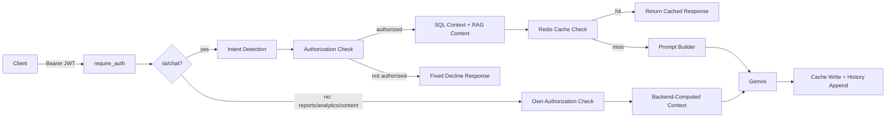

# ClubConnect AI Backend

The AI Services module (`app/modules/ai_services/`) for the ClubConnect university club management platform — a role-aware conversational assistant, report generator, analytics interpreter, and content drafter, built on top of the existing Flask/SQLAlchemy backend.

## Overview

The AI layer adds five capabilities to ClubConnect, all mounted under `/api/ai`:

- **AI Chat** (`/ai/chat`) — conversational Q&A across a 22-intent catalog (club discovery, memberships, attendance, rewards, financial operations, admin oversight, etc.), each with its own authorization rule.
- **Intent routing** — a keyword pre-filter over the intent catalog, with a Gemini-based fallback classifier for messages the keyword pass can't resolve confidently.
- **RAG (retrieval-augmented generation)** — a knowledge base of System Documents (always-injected behavior rules) and RAG Documents (retrieved on demand per intent) backing the chat responses.
- **Reports** (`/ai/reports`) — 9 one-shot narrative report types (`student_activity`, `attendance`, `membership`, `reward`, `support_ticket`, `volunteer`, `club_activity`, `budget`, `emergency_summary`).
- **Analytics** (`/ai/analytics/financial`, `/ai/analytics/performance`) — backend-computed figures + AI-written explanation, no forecasting.
- **Content generation** (`/ai/content`) — 10 short draft-content types (announcements, invitations, etc.), available to every role.
- **Redis-backed response caching + short conversation memory** — applies only to `/ai/chat`, fails soft when Redis is unavailable.
- **Role-aware responses / RBAC** — every intent, report type, and analytics endpoint enforces its own authorization rule against the caller's platform role (`users.role`) and club-scoped role(s) (`club_memberships.role_in_club`).

See `AI_API_REFERENCE.md` for the full endpoint-by-endpoint contract, and `AI_API.yaml` for the OpenAPI section to merge into the team's master spec.

## Architecture

```
Client
  → Authorization header (JWT) validated (require_auth)
  → AI routes (app/modules/ai_services/routes.py)
      ├─ /chat: intent detection (keyword pre-filter → Gemini fallback if ambiguous)
      │         → authorization check (platform role + club-scoped role)
      │         → SQL context builder (scoped to caller) + RAG retriever
      │         → Redis cache check (cacheable intents only)
      │         → prompt builder → Gemini → cache write + conversation-memory append
      └─ /reports, /analytics/*, /content: no intent detection, no RAG, no caching —
                each authorizes itself, pulls a backend-computed context, and makes
                exactly one Gemini call to turn that context into prose
  → response
```



## AI Module Structure

```
app/modules/ai_services/
├── routes.py                  # All /api/ai/* endpoints
├── intent_router.py           # 22-intent catalog, keyword detection, authorization, Gemini fallback classifier
├── sql_context_builder.py     # Per-intent scoped SQL context (Phase 3/5B/6, untouched by later phases)
├── rag_retriever.py           # RAG retrieval for chat intents with rag_docs
├── rag/                       # Chunking, embeddings, vector store, retrieval service
├── prompt_builder.py          # Assembles System Documents + SQL/RAG context + history into one prompt
├── gemini_client.py           # Thin wrapper around google-genai; GeminiConfigError / GeminiRequestError
├── cache.py                   # Redis response cache + short conversation memory (chat only)
├── report_service.py          # 9-type report catalog + access rules
├── report_context.py          # Phase 6B-only aggregations report_service.py needs (club activity, volunteer, emergency summary, platform budget)
├── analytics_service.py       # Financial + Performance analytics (access rules, chart data)
├── content_service.py         # 10 content-draft types
├── prompts/                   # Prompt text templates (chatbot_prompt.py)
├── knowledge_base/
│   ├── system/                 # Always-injected behavior docs
│   └── rag/                    # Retrieved-on-demand process docs
└── tests/                      # Unit tests for every module above

app/core/redis.py               # Redis client singleton (fail-soft: returns None if unreachable)
app/core/celery.py              # Celery app — one scheduled job (cache cleanup)
app/tasks/cache_tasks.py        # cleanup_expired_cache Celery task
```

## Requirements

- Python (this project's `requirements.txt` targets Flask 3.1.2 / SQLAlchemy 2.0.43 — install into a matching or compatible interpreter; the repo's own database README documents its setup against a virtual environment created with the system `python`)
- A virtual environment (`.venv`) inside the backend folder
- Redis (optional — the AI cache/history feature degrades gracefully without it; required only if you want to test caching)
- A Gemini API key (`GEMINI_API_KEY`) — every AI endpoint except `/ai/health` needs this configured to return anything other than a `503`
- SQLite — no separate database server to install; the app creates `app/database/clubconnect.db` on first run

## Environment Configuration

Create a `.env` file in the backend root with (placeholders shown — never commit real values):

```
GEMINI_API_KEY=<your-key>
GEMINI_MODEL=<configured-model>          # defaults to "gemini-2.5-flash" if unset

# JWT
JWT_SECRET_KEY=<your-secret>
JWT_ACCESS_TOKEN_EXPIRES=<seconds>       # optional, defaults to 3600

# Optional (if using Redis)
REDIS_URL=redis://localhost:6379/0       # optional, defaults to redis://localhost:6379/0
AI_CACHE_TTL_SECONDS=3600                # optional, response cache TTL
AI_CACHE_HISTORY_TTL_SECONDS=86400       # optional, conversation-memory TTL
CELERY_BROKER_URL=<redis url>            # optional, defaults to REDIS_URL
CELERY_RESULT_BACKEND=<redis url>        # optional, defaults to CELERY_BROKER_URL

# Only needed if you use the corresponding auth/email features
GOOGLE_CLIENT_ID=<your-google-client-id>
GMAIL_ADDRESS=<your-gmail-address>
GMAIL_APP_PASSWORD=<your-app-password>
VITE_FRONTEND_URL=<frontend-url>         # optional, defaults to http://localhost:5173
KNOWLEDGE_BASE_DIR=<path>                # optional, defaults to app/modules/ai_services/knowledge_base
```

Only the variables actually read by `app/config.py` / `cache.py` / `app/core/celery.py` are listed above — nothing here is invented.

## Installation

From the backend project root (PowerShell shown; CMD/WSL equivalents noted where they differ):

```powershell
# 1. Clone repository (skip if already cloned)
git clone <repository-url>
cd <repository-folder>

# 2. Move into the backend folder
cd Application\backend

# 3. Create and activate a virtual environment
python -m venv .venv
.venv\Scripts\Activate.ps1        # CMD: .venv\Scripts\activate
                                   # WSL/Linux/macOS: source .venv/bin/activate

# 4. Install dependencies
pip install -r requirements.txt

# 5. Configure .env (see Environment Configuration above)

# 6. Initialize the SQLite database (from the app/ folder)
cd app
python -m database.init_db

# 7. Verify it
python -m database.verify_db

# 8. Load sample data (optional, for testing — see "API Testing" below)
python -m database.seed_sample_data

# 9. Start Redis if you want to test caching (see "Running Redis" below)

# 10. Start the Flask application (from the backend root, one level up from app/)
cd ..
python main.py
```

The app runs on `http://127.0.0.1:5000` by default (Flask's `app.run(debug=True)` in `main.py`); all AI endpoints are under `http://127.0.0.1:5000/api/ai`.

## Running Redis

Native Redis doesn't have official Windows support, so for reliable local testing of the caching behavior, run it inside **WSL** or **Docker** rather than trying to install a Windows Redis build directly:

**Docker (any OS):**
```bash
docker run -d --name clubconnect-redis -p 6379:6379 redis:7
```

**WSL (Ubuntu):**
```bash
sudo apt update && sudo apt install redis-server
sudo service redis-server start
```

**Check it's running:**
```bash
redis-cli ping
# expected: PONG
```

If `redis-cli ping` doesn't return `PONG`: confirm the Redis process is actually running (`docker ps` / `sudo service redis-server status`), confirm `REDIS_URL` in `.env` matches where Redis is actually listening (`redis://localhost:6379/0` by default — if Redis is in WSL and the backend runs on native Windows, you may need the WSL instance's IP instead of `localhost`, or run the backend inside WSL too), and confirm nothing else is already bound to port 6379.

**Inspecting cache keys (local dev only):**
```bash
redis-cli --scan --pattern "aicache:resp:*"       # response cache entries
redis-cli --scan --pattern "aicache:history:*"    # conversation history
redis-cli --scan --pattern "aicache:userkeys:*"   # per-user key-tracking sets
```
Prefer `--scan` over `KEYS *` outside a local/dev instance — `KEYS *` blocks the server on a large keyspace. `redis-cli monitor` can be used cautiously to watch live cache traffic during a manual test, but don't leave it running against a shared instance.

**If Redis is unavailable:** `app/core/redis.py`'s `get_redis_client()` never raises — it returns `None`, and every function in `cache.py` degrades to a no-op (cache miss / empty history / no-op invalidation). The AI service keeps working exactly as if caching didn't exist; only `/ai/chat`'s `cache_hit` field and conversation memory are affected — no other endpoint or platform feature depends on Redis at all.

## Running the Application

```powershell
# from the backend root, with the virtual environment activated
python main.py
```

No other startup command is defined in this repository (no WSGI server config, no Docker Compose for the app itself, found in the supplied ZIP) — `python main.py` runs Flask's built-in dev server in debug mode.

## API Testing

1. **Authenticate:**
   ```bash
   curl -X POST http://127.0.0.1:5000/api/auth/login \
     -H "Content-Type: application/json" \
     -d '{"email": "priya.sharma@campus.edu", "password": "ClubConnect#2026"}'
   ```
   (Sample credentials from `app/database/seed_sample_data.py` — explicitly documented in that file as fictional and safe to publish for this project. All 9 seeded users share the password `ClubConnect#2026`.)

2. **Set the Authorization header** on every subsequent call:
   ```bash
   curl http://127.0.0.1:5000/api/ai/health
   curl -X POST http://127.0.0.1:5000/api/ai/chat \
     -H "Authorization: Bearer <access_token>" \
     -H "Content-Type: application/json" \
     -d '{"message": "what clubs am I a member of?"}'
   ```

3. **Test different roles** — log in as each sample user (see the Role-Based Testing Matrix below) and repeat role-gated requests.

4. **Test success** — a `200` with `"status": "ok"`.

5. **Test 401** — call any endpoint but `/ai/health` with no `Authorization` header, or an expired/invalid/revoked token.

6. **Test validation errors** — e.g. `POST /ai/chat` with an empty `message`, or `POST /ai/content` with a missing/unknown `content_type`.

7. **Test reports** — `POST /ai/reports` with each of the 9 `report_type` values, as different roles (see `AI_API_REFERENCE.md` Section 4 for the full access matrix), plus one unknown `report_type` to confirm the `400` path.

8. **Test analytics** — `POST /ai/analytics/financial` as a treasurer/faculty/admin-tier user (authorized) and as a plain student (not authorized, still `200`); `POST /ai/analytics/performance` as each role to see the four `scope` values.

9. **Test content generation** — `POST /ai/content` with and without `details`, to see the generic-vs-specific draft behavior described in `AI_API_REFERENCE.md` Section 6.

10. **Test caching** — see "Caching Test" below.

## Role-Based Testing Matrix

Sample login accounts (`app/database/seed_sample_data.py`, password `ClubConnect#2026` for all):

| Email | Platform role |
|---|---|
| `priya.sharma@campus.edu` | student |
| `arjun.mehta@campus.edu` | student |
| `ananya.gupta@campus.edu` | student |
| `dr.rao@campus.edu` | faculty_advisor |
| `dean.welfare@campus.edu` | dean_student_welfare |
| `affairs.office@campus.edu` | student_affairs_office |
| `admin@campus.edu` | system_admin |
| `rohit.singh@campus.edu` | student |
| `kavya.iyer@campus.edu` | student (Google SSO) |

A **club treasurer** is a club-scoped role (`club_memberships.role_in_club`), not one of the platform roles above — check `app/database/sql/sample_data.sql` / `seed_sample_data.py`'s membership rows for which seeded student(s) hold `TREASURER` in which club, or query `club_memberships` directly after seeding. The supplied test evidence confirms at least one seeded student account is a genuine club treasurer and correctly receives club-scoped financial access under that role.

### Student
- Allowed: all role-orthogonal chat intents, all 6 personal report types, Performance Analytics (`scope: "personal"`), all content types.
- Denied: `Financial Operations`/`Faculty Questions`/`Admin Questions` chat intents, `budget`/`emergency_summary` reports, Financial Analytics — **unless** they hold a club-scoped Treasurer role, in which case `Financial Operations`, `budget`, and Financial Analytics are allowed, scoped to that club only.
- Personal data scope: own memberships, attendance, rewards, tickets, volunteer assignments only.

### Club Treasurer/Officer
- Treasurer: club-scoped financial access (`Financial Operations` chat intent, `budget` report, Financial Analytics) limited to the club(s) they treasurer.
- Any officer-tier role (President/VP/Secretary/Event or Volunteer Coordinator/Treasurer): `club_activity` report and Performance Analytics `scope: "led_clubs"`, scoped to their club(s).

### Faculty Advisor
- `Financial Operations` and `Faculty Questions` chat intents, `budget` report, Financial Analytics, Performance Analytics `scope: "advised_clubs"` — all scoped to clubs they advise.
- No `Admin Questions` chat intent or `emergency_summary` report.

### System Administrator (and Student Affairs Office / Dean of Student Welfare — same "admin-tier" bucket)
- `Admin Questions` chat intent, every report type including `budget` (platform-wide aggregate when they hold no club themselves) and `emergency_summary`, Financial Analytics, Performance Analytics `scope: "platform"`.
- Scoped to their own `university_id` where the underlying data model supports it.

## Caching Test

1. Start Redis (see "Running Redis").
2. Verify `redis-cli ping` → `PONG`.
3. Start the backend (`python main.py`) while Redis is reachable.
4. Authenticate (see "API Testing" step 1).
5. Call a cacheable chat intent, e.g. `{"message": "what clubs am I a member of?"}` (maps to `Membership`, which is cacheable).
6. Record `cache_hit` — expect `false` on the first call.
7. Send the **exact same** request again (same user, same message text).
8. Record `cache_hit` — expect `true`, with `response` identical to step 6.
9. Expected behavior: cacheable intents are keyed on `user_id + role + intent + normalized_prompt` (SHA-256'd) with a default TTL of `AI_CACHE_TTL_SECONDS` (1 hour); non-cacheable intents (e.g. `Financial Operations`, `Rewards`, `Admin Questions`) always show `cache_hit: false` since they're never looked up in the cache. `/ai/reports`, `/ai/analytics/*`, and `/ai/content` are **never** cached at all, regardless of the request.
10. Optionally inspect keys: `redis-cli --scan --pattern "aicache:resp:*"`.

Not every request is expected to cache — see `AI_API_REFERENCE.md` Section 7 for the full cacheable/non-cacheable intent list. The exact request must remain identical (same normalized message text) for a cache hit, since the cache key includes the normalized prompt.

## API Endpoint Summary

| Method | Route | Purpose | Role/access notes | Cacheable |
|---|---|---|---|---|
| GET | `/api/ai/health` | Config/knowledge-base health check | Public | n/a |
| POST | `/api/ai/chat` | Conversational Q&A (22 intents) | Per-intent (see `AI_API_REFERENCE.md` §3) | Per-intent (10 of 22 are cacheable) |
| POST | `/api/ai/reports` | 9 narrative report types | Per-report-type (see §4) | No |
| POST | `/api/ai/analytics/financial` | Budget/expense analytics | Treasurer / Faculty / admin-tier | No |
| POST | `/api/ai/analytics/performance` | Engagement/performance analytics | Every role (auto-scoped) | No |
| POST | `/api/ai/content` | Draft content generation (10 types) | Every role | No |

## Testing / Verification

Automated tests exist under `app/modules/ai_services/tests/` (one file per module — `test_intent_router.py`, `test_sql_context_builder.py`, `test_rag_*.py`, `test_prompt_builder.py`, `test_gemini_client.py`, `test_cache.py`, `test_phase6b.py` covering reports/analytics/content, `test_routes.py`) and `app/database/tests/`.

Run them with:
```powershell
python -m pytest app\modules\ai_services\tests\ -v
python -m pytest app\database\tests\ -v
```

Per this project's own `TEST_REPORT.md`: the most recent full run reported **220 passed, 0 failed** in `app/modules/ai_services/tests/` (194 pre-existing across Phases 2–6A + 26 new for Phase 6B — reports/analytics/content), with Gemini calls mocked in that session (the test sandbox couldn't reach Google's live API). `app/database/tests/` reported 50 passed with 5 pre-existing, unrelated failures documented in that project's own `PROJECT_CONTEXT.md` (schema/audit-log drift unrelated to the AI module). These figures are as reported in the project's own test documentation, not independently re-run as part of producing this documentation pass.

## Troubleshooting

### Redis connection problems
**Symptoms:** `cache_hit` stays `false` even on an identical repeated request; no entries under `redis-cli --scan --pattern "aicache:*"`.
**Checks:**
- `redis-cli ping` → should return `PONG`
- Confirm the Redis process/container is actually running
- Confirm `REDIS_URL` in `.env` matches where Redis is listening
- If Redis is in WSL/Docker and the backend runs natively on Windows, confirm network reachability between them (may need the WSL/container IP instead of `localhost`)
- Confirm the intent you're testing with is actually in the cacheable list (`AI_API_REFERENCE.md` §7) — a non-cacheable intent will *always* show `cache_hit: false`, which is correct, not a bug

### 401 / 403
This API does not return `403` for role limitations — a role/club-role restriction on `/chat`, `/reports`, or `/analytics/financial` is a `200` with `"authorized": false`. A `401` specifically means authentication failed: missing/malformed `Authorization` header, expired JWT, or a token that's been revoked server-side (logout, or no longer present in the session table).

### Gemini/API key problems
Call `GET /api/ai/health` (no auth needed) and check `gemini_api_key_configured`. If `false`, set `GEMINI_API_KEY` in `.env` and restart the app — never check the actual key value into any log, doc, or response; the health endpoint only reports whether it's set (a boolean), not the value.

### Empty/insufficient AI responses
For `/ai/content`: an empty or missing `details` field does **not** cause an error — it produces a deliberately generic draft (Gemini is instructed never to invent specifics), so if you expect a specific draft, supply concrete details in the request rather than treating a generic result as a bug.

## Security Notes

- Never commit `.env`.
- Never commit `GEMINI_API_KEY`, `JWT_SECRET_KEY`, `REDIS_URL` (if it embeds credentials), `GMAIL_APP_PASSWORD`, or any JWT/access token.
- Use placeholders (`<your-key>`) in all documentation, including this file.
- Do not paste real API response bodies containing a live `access_token` into docs, issues, or PR descriptions — redact tokens even in "here's what I tested" examples.